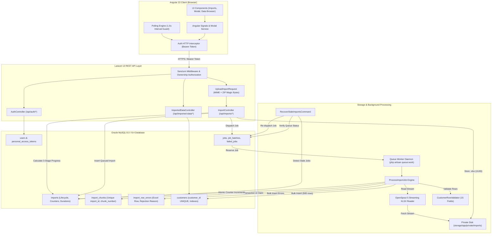
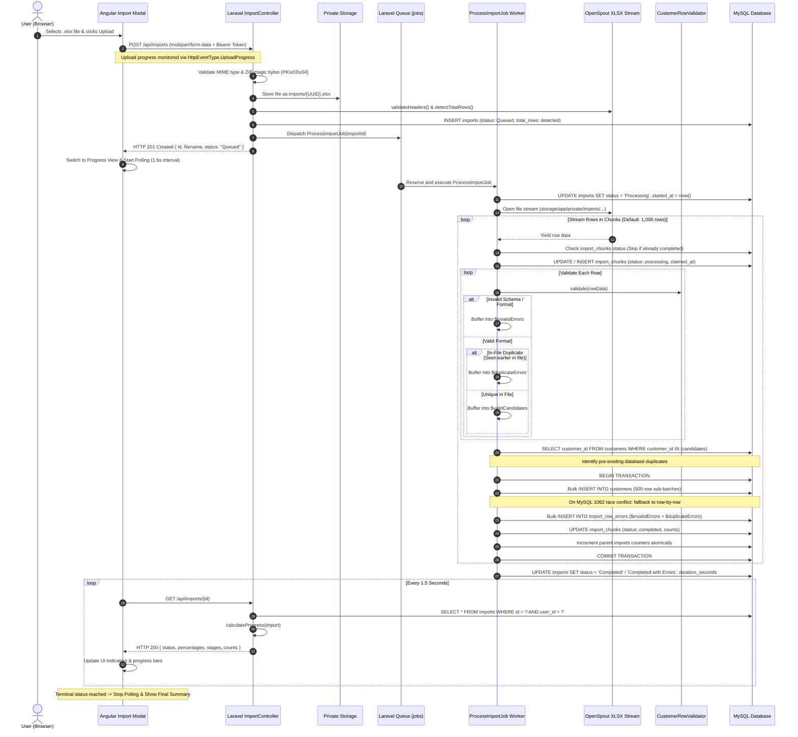
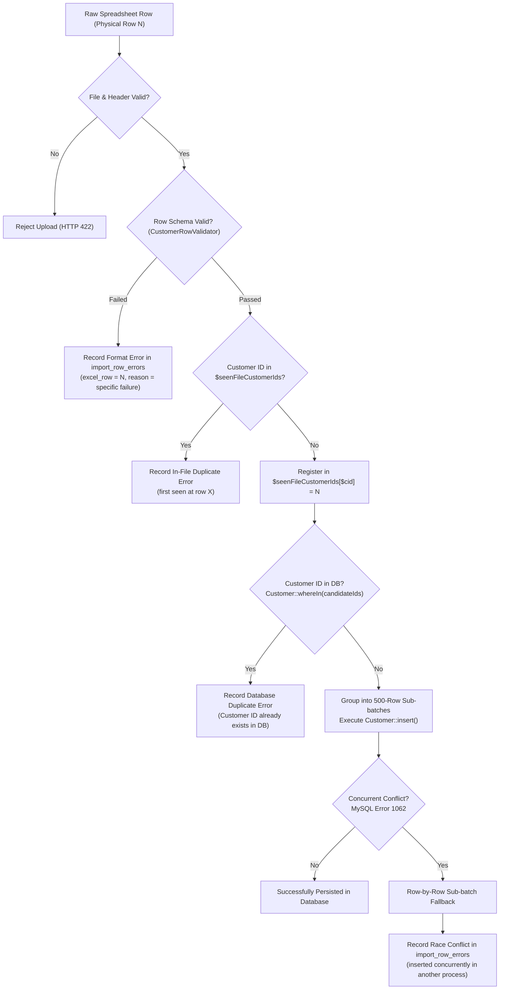
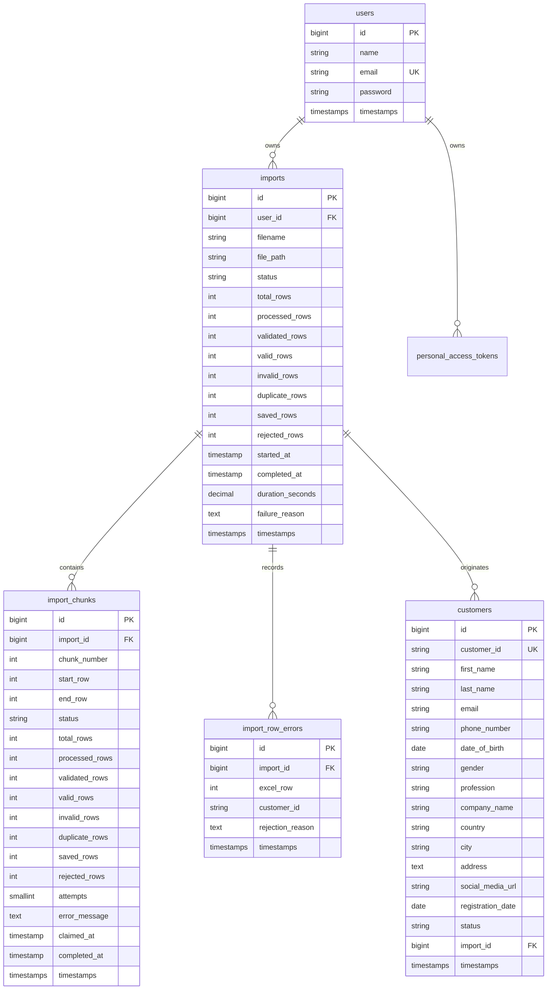
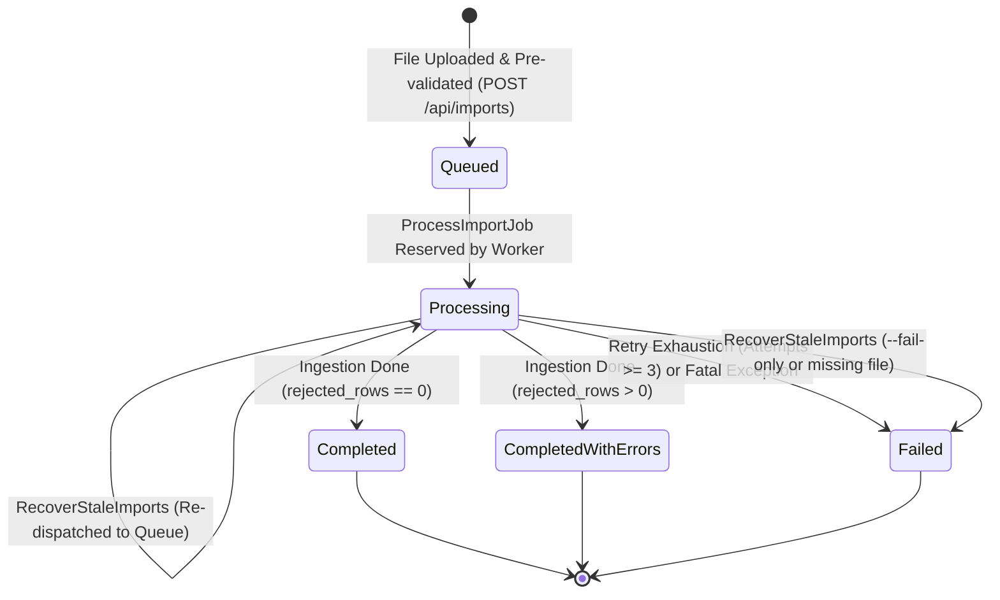
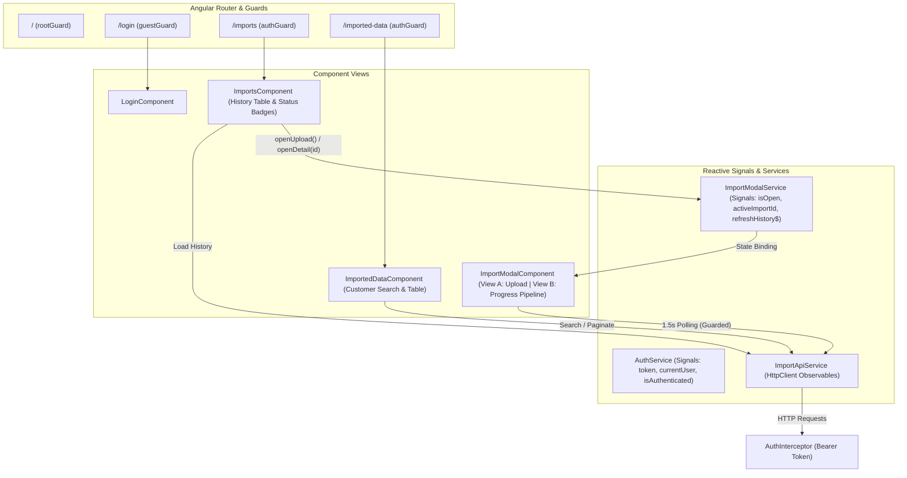

# System Architecture Documentation: Large-Scale Excel Import Engine

## 1. System Overview

The **Large-Scale Excel Import Engine** is an enterprise-grade asynchronous processing system built to upload, validate, and ingest high-volume `.xlsx` spreadsheets containing up to **500,000 records per file**. The system maintains strictly bounded memory usage (< 100 MB), multi-tier duplicate prevention, idempotent queue retries, failure recovery, and authenticated per-user data isolation.

The application is decoupled into two primary subsystems:
1. **Backend REST API & Processing Engine (Laravel 13):** Handles secure file ingestion, streaming XLSX parsing via OpenSpout 5, row-level schema validation, multi-tier duplicate detection, database chunk transactions, queue worker supervision, and recovery commands.
2. **Frontend Client Application (Angular 22):** A standalone component Single Page Application (SPA) utilizing Angular Signals, reactive HTTP interceptors, three-stage pipeline progress tracking, paginated error audits, and formula-injection-protected CSV exports.

---

## 2. Core Architecture Principles & Design Decisions

| Principle | Design Choice | Rationale & Code Traceability |
| :--- | :--- | :--- |
| **Zero-DOM Streaming** | OpenSpout 5 Reader | Traditional DOM parsers (e.g. PhpSpreadsheet) build complete in-memory node trees consuming 1.5–3.0 GB of RAM for 500k rows. OpenSpout streams XML nodes iteratively with flat memory (~15–25 MB). Traceable to [`ExcelParserService.php`](file:///var/www/html/import/backend/app/Services/ExcelParserService.php). |
| **Asynchronous Ingestion** | Database Queue & Background Job | The HTTP request never parses data rows. It verifies headers, stores the file, creates a `Queued` record, and returns HTTP 201 immediately (< 200 ms). Processing executes in [`ProcessImportJob.php`](file:///var/www/html/import/backend/app/Jobs/ProcessImportJob.php). |
| **Transactional Chunking** | 1,000-Row Chunks, 500-Row Sub-batches | Rows are buffered up to `chunk_size` (1,000) and committed within isolated `DB::transaction()` blocks. Sub-batching at 500 rows adheres to MySQL SQL parameter limits. |
| **Multi-Tier Duplicate Prevention** | 3-Tier Layered Defense | Tier 1: In-file hash set. Tier 2: In-database `whereIn` index query. Tier 3: Database unique constraint with sub-batch fallback catching MySQL error 1062. |
| **Idempotent Execution** | `import_chunks` Table | Each chunk is indexed by `(import_id, chunk_number)`. Retrying a partially failed job bypasses already `completed` chunks without re-inserting records or double-incrementing counters. |
| **Stale Worker Recovery** | Scheduled Command & Queue Polling | Detects orphaned `Processing` imports after worker crashes (`SIGKILL`, reboot) and safely re-dispatches or marks them `Failed`. Traceable to [`RecoverStaleImportsCommand.php`](file:///var/www/html/import/backend/app/Console/Commands/RecoverStaleImportsCommand.php). |
| **Per-User Ownership Isolation** | Sanctum Bearer Auth & Tenant Scoping | All imports, records, errors, and CSV downloads are strictly scoped to the authenticated user ID. Cross-user access returns HTTP 403. |
| **Spreadsheet Security** | Formula Injection Neutralization | Streamed CSV error reports prefix formula trigger characters (`=`, `+`, `-`, `@`, `\t`, `\r`) with a single quote (`'`). Sensitive server paths and database passwords are sanitized from logs. |

---

## 3. High-Level System Architecture

The following diagram illustrates the interaction between the Angular client, the Laravel API layer, the queue engine, the file storage system, and the MySQL database:



---

## 4. Component Responsibilities & Boundaries

### 4.1 Angular Frontend Subsystem
* **`AuthService` (`services/auth.service.ts`):** Manages user session state in `localStorage` (`excel_import_token`, `excel_import_user`), exposes reactive signals (`token`, `currentUser`, `isAuthenticated`), and handles login/logout API requests.
* **`AuthInterceptor` (`interceptors/auth.interceptor.ts`):** Automatically injects `Authorization: Bearer <token>` into outgoing requests; catches HTTP 401 Unauthorized responses, clears session state, and redirects to `/login`.
* **`ImportApiService` (`services/import-api.service.ts`):** Centralized HTTP client wrapping all backend endpoints (`upload`, `getImport`, `getImports`, `getImportErrors`, `downloadErrorsCsv`, `downloadSampleTemplate`, `getImportedData`, `deleteAllImportedData`).
* **`ImportModalService` (`services/import-modal.service.ts`):** Controls visibility and active target ID for the modal dialog; broadcasts `refreshHistory$` events to keep the history table synchronized.
* **`ImportModalComponent` (`components/import-modal/`):** Two-view modal dialog:
  * *View A (Upload):* Drag-and-drop file target, `.xlsx` extension and 100 MB size checks, sample template download, and real upload progress bar via `HttpEventType.UploadProgress`.
  * *View B (Progress & Audit):* Three-stage pipeline cards (Upload, Validation, Import), real-time counter metrics, failure alert display, paginated error list, and error CSV download.
* **`ImportsComponent` (`components/imports/`):** Paginated import history screen displaying filename, status badge, record counters, duration, created timestamp, and detail view triggers.
* **`ImportedDataComponent` (`components/imported-data/`):** Paginated customer database browser with search filtering and protected bulk data cleanup.

### 4.2 Laravel Backend Subsystem
* **`AuthController` (`app/Http/Controllers/Api/AuthController.php`):** Issues plain-text Sanctum personal access tokens on valid email/password authentication; revokes tokens on logout; returns current user identity.
* **`ImportController` (`app/Http/Controllers/Api/ImportController.php`):**
  * *`store()`:* Handles file upload, saves file to private disk with a UUID filename, executes structural header pre-validation, detects XML dimensions, creates an `Import` record, and dispatches `ProcessImportJob`.
  * *`show()`:* Enforces ownership authorization, computes three-stage progress via `calculateProgress()`, and returns detailed execution counters.
  * *`index()`:* Returns user-scoped paginated import history ordered by `created_at desc`.
  * *`errors()`:* Returns paginated row-level errors for an import.
  * *`downloadErrorsCsv()`:* Streams a UTF-8 BOM CSV error report with spreadsheet formula injection protection.
  * *`downloadSampleTemplate()`:* Streams a 20-row sample `.xlsx` template.
* **`ImportedDataController` (`app/Http/Controllers/Api/ImportedDataController.php`):** Paginated customer querying with full-name and customer ID search; scoped data deletion requiring explicit confirmation string `"DELETE ALL DATA"`.
* **`CustomerRowValidator` (`app/Services/CustomerRowValidator.php`):** Stateless row validation service enforcing constraints across all 15 required and optional fields. Converts Excel numeric serial dates to `Y-m-d` format and normalizes status values.
* **`ExcelParserService` (`app/Services/ExcelParserService.php`):** Manages OpenSpout reader/writer instances. Performs O(1) row count detection by reading XML dimensions from package headers without parsing data rows. Normalizes column headers using configured alias dictionaries.
* **`ProcessImportJob` (`app/Jobs/ProcessImportJob.php`):** Asynchronous queued job managing stream iteration, chunk buffering, validation, multi-tier duplicate prevention, transactional bulk insertion, error recording, atomic progress counter increments, and terminal state updates.
* **`RecoverStaleImportsCommand` (`app/Console/Commands/RecoverStaleImportsCommand.php`):** Artisan command (`import:recover-stale`) detecting stuck imports whose queue workers crashed. Checks database queue reservations and re-dispatches or fails stale imports safely.
* **Benchmark Tooling (`app/Console/Commands/`):**
  * *`MakeSample500kCommand`:* Generates reproducible 500,000-row sample spreadsheets using zero-memory streaming.
  * *`BenchmarkImportCommand`:* Coordinates end-to-end benchmark runs, measures execution time and peak memory, and verifies 8 data integrity invariants.

---

## 5. Complete End-to-End Import Lifecycle

The sequence diagram below illustrates the exact execution path from browser upload through asynchronous queued processing, multi-tier duplicate prevention, database persistence, and polling completion:



---

## 6. Excel Ingestion & Streaming Memory Architecture

### 6.1 OpenSpout 5 Streaming Engine
Standard spreadsheet libraries (such as PhpSpreadsheet) construct complete object graphs representing sheets, rows, cells, and styles in memory, leading to memory consumption between 1.5 GB and 3.0 GB for a 500,000-row file.

This application uses **OpenSpout 5**, which streams rows directly from the underlying zipped XML stream (`xl/worksheets/sheet1.xml`) using PHP's `XMLReader`. Only one row exists in memory at any given time.
* **Generator Peak Memory:** **26.0 MB** (flat line across 500,000 generated rows).
* **Worker Ingestion Peak Memory:** **82.0 MB** (measured during full 500,000-row import).

### 6.2 Pre-flight Dimension Detection
Rather than iterating through the entire file to determine row counts, `ExcelParserService::detectTotalRows()` opens the `.xlsx` package as a `ZipArchive`, streams the first 4,096 bytes of the worksheet XML, and extracts the dimension attribute using regex:
```xml
<dimension ref="A1:O500001"/>
```
This enables instantaneous $O(1)$ detection of total expected rows prior to queue processing.

---

## 7. Validation & Multi-Tier Duplicate Prevention Architecture

Data integrity is protected through a 5-stage validation and duplicate prevention pipeline:



### 7.1 Field-Level Validation Rules (`CustomerRowValidator`)
All 15 fields are validated according to the following constraints:

| Column Name | Required / Optional | Validation Constraint | Normalization / Parsing |
| :--- | :---: | :--- | :--- |
| **Customer ID** | Required | Non-empty string, max 100 characters. | Trimmed. Unique index enforced in DB. |
| **First Name** | Required | Non-empty string, max 150 characters. | Trimmed. |
| **Last Name** | Required | Non-empty string, max 150 characters. | Trimmed. |
| **Email** | Required | Valid email via `FILTER_VALIDATE_EMAIL`, max 255 characters. | Lowercased, trimmed. |
| **Phone Number** | Required | Matches `/^\+?[0-9\s().\-\/]{7,25}$/` and 7–18 digits. | Trimmed. |
| **Date of Birth** | Required | Valid date format. Supports standard strings and Excel numeric serial dates. | Converted to `Y-m-d`. Range: 1900–2100. |
| **Gender** | Optional | Max 50 characters if provided. | Nullable, trimmed. |
| **Profession** | Required | Non-empty string, max 150 characters. | Trimmed. |
| **Company Name** | Optional | Max 150 characters if provided. | Nullable, trimmed. |
| **Country** | Required | Non-empty string, max 100 characters. | Trimmed. |
| **City** | Required | Non-empty string, max 100 characters. | Trimmed. |
| **Address** | Optional | Text field. | Nullable, trimmed. |
| **Social Media URL** | Optional | Valid URL via `FILTER_VALIDATE_URL`, max 500 characters. | Nullable, trimmed. |
| **Registration Date**| Required | Valid date format. Supports strings and Excel serial dates. | Converted to `Y-m-d`. Range: 1900–2100. |
| **Status** | Required | Must equal `'Active'` or `'Inactive'` (case-insensitive). | Normalized to `'Active'` or `'Inactive'`. |

### 7.2 Multi-Tier Duplicate Prevention
1. **Tier 1 (In-File Duplicates):** An in-memory hash map `$seenFileCustomerIds[$customerId] = $excelRow` tracks candidate IDs across the file. The first valid appearance is queued for insertion; subsequent occurrences are rejected:
   `"Duplicate Customer ID '{id}' within file (first seen at row {firstRow})."`
2. **Tier 2 (Database Duplicates):** Before executing chunk transactions, candidates are checked against the MySQL primary index:
   ```php
   Customer::whereIn('customer_id', $candidateIds)->pluck('customer_id')
   ```
   Matches are rejected: `"Customer ID '{id}' already exists in database."`
3. **Tier 3 (Concurrency Race Protection & Sub-batch Isolation):** The `customers.customer_id` column has a unique database index (`customers_customer_id_unique`). To handle race conditions between parallel imports, records are inserted in 500-row sub-batches. If a concurrent worker inserts an ID after Tier 2 check runs, a MySQL QueryException 1062 is caught. Only that specific 500-row sub-batch falls back to row-by-row insertion, isolating the conflicting record and recording:
   `"Customer ID '{id}' was inserted concurrently in another process."`
   Earlier successful sub-batches remain safely committed.

---

## 8. Queue, Chunk Processing & Idempotency

### 8.1 Queue Configuration & Job Parameters
* **Queue Driver:** Database driver (`QUEUE_CONNECTION=database`), backed by the `jobs` and `job_batches` tables.
* **Worker Execution Command:**
  ```bash
  php artisan queue:work --queue=default --timeout=3600 --tries=3
  ```
* **Job Properties (`ProcessImportJob`):**
  * `public int $tries = 3;`
  * `public int $timeout = 3600;` (1 hour execution ceiling)

### 8.2 Chunk Isolation & Transaction Boundaries
* Each chunk is processed within an explicit `DB::transaction()` block.
* Chunk progress is tracked in `import_chunks` with a unique constraint on `(import_id, chunk_number)`.
* If a chunk fails midway (e.g. database connection blip), the transaction rolls back cleanly, leaving zero partial rows in `customers` or `import_row_errors`.

### 8.3 Idempotent Resume Behavior
When a job retries after an interruption:
1. It opens the spreadsheet from row 2.
2. For each chunk, it inspects `import_chunks`:
   ```php
   $existingChunk = ImportChunk::where('import_id', $import->id)
       ->where('chunk_number', $chunkNumber)
       ->first();
   ```
3. If `$existingChunk->status === ImportChunk::STATUS_COMPLETED`, the job skips insertion and counter increments for that chunk, while registering its Customer IDs in `$seenFileCustomerIds` to maintain duplicate detection accuracy for later rows.
4. Processing resumes seamlessly at the first uncompleted chunk.

---

## 9. Database Architecture

The persistence model consists of 4 application tables, 3 queue/cache tables, and 2 authentication tables:



### Key Indexes and Constraints
* **`customers.customer_id`:** `UNIQUE` index. Guarantees zero duplicate customers across the entire system.
* **`customers.email`:** B-tree index for lookup performance.
* **`customers.status`:** B-tree index for filtering active/inactive records.
* **`imports.status` & `imports.created_at`:** B-tree indexes for fast dashboard history pagination.
* **`imports.(user_id, created_at)`:** Composite index for per-user ownership scoping.
* **`import_chunks.(import_id, chunk_number)`:** `UNIQUE` composite index. Guarantees chunk idempotency.
* **`import_chunks.(import_id, status)`:** Composite index for chunk status queries.
* **`import_row_errors.(import_id, excel_row)`:** Composite index for ordering errors by physical row number.
* **`import_row_errors.(import_id, id)`:** Composite index for paginated error retrieval.

---

## 10. Import Status & Progress Lifecycle

### 10.1 Status Transition State Machine



### 10.2 Three-Stage Pipeline Progress Calculation
The `calculateProgress()` method in `ImportController` computes real-time percentages and indeterminate states across three distinct stages:

1. **Stage 1 (File Upload):**
   * Handled in the browser via Angular `HttpEventType.UploadProgress`. Shows true bytes transferred (0% to 100%).
   * Displayed as completed (100%) in the modal detail view once stored on the server.
2. **Stage 2 (Excel Row Validation):**
   * Tracks `validated_rows` vs `total_rows`.
   * Percentage: `min(99.9, (validated_rows / total_rows) * 100)`.
   * Reaches `100.0%` upon terminal completion. Displays indeterminate scanning animation when total rows are unknown.
   * Reports distinct metrics: **Checked Rows**, **Valid Rows**, **Invalid Rows**, and **Duplicate Rows**.
3. **Stage 3 (Database Import):**
   * Tracks `saved_rows` against eligible rows (`valid_rows`).
   * If validation is still ongoing across preceding chunks, Stage 3 is marked **`indeterminate`** to prevent misleading jumps to 100%.
   * Once all rows are validated, percentage reflects: `min(99.9, (saved_rows / eligible_rows) * 100)`.
   * Reaches `100.0%` only when all eligible rows are persisted.

---

## 11. Failure Handling & Recovery Architecture

| Failure Scenario | Detection Mechanism | Recovery & Handling Action | Resulting System State |
| :--- | :--- | :--- | :--- |
| **Corrupt File / Invalid Extension** | Form request validation in `UploadImportRequest`. | Checks `.xlsx` extension, allowed MIME types, and binary ZIP header (`PK\x03\x04`). Returns HTTP 422 before storage. | File rejected immediately. No database records created. |
| **Missing Required Header Columns** | `ExcelParserService::validateHeaders()`. | Reads row 1 of sheet 1; verifies all 11 required columns match aliases. Deletes uploaded file and returns HTTP 422. | File cleaned from disk. Import aborted before queueing. |
| **Transient Database Lock / Worker Crash** | Caught in `ProcessImportJob::handle()`. | If queue `$this->attempts() < $this->tries`, exception is re-thrown. Status remains `Processing`. Next retry resumes at uncompleted chunk. | Chunks are idempotent. Completed chunks are never re-inserted. |
| **Queue Worker Killed (`SIGKILL` / OOM)** | Inactivity threshold detected by `RecoverStaleImportsCommand`. | `php artisan import:recover-stale` queries imports stuck in `Processing` > 15m without active job reservations. Verifies file exists and re-dispatches. | Stale imports resume execution safely or transition to `Failed`. |
| **Queue Retry Exhaustion** | Queue worker invokes `failed()` lifecycle hook. | `ProcessImportJob::failed()` executes `Import::markFailed()`. Scrubs credentials, records `completed_at` and `duration_seconds`. | Import transitions to `Failed` with sanitized error message. |
| **Spreadsheet Formula Injection** | Cell content inspection in `sanitizeCsvCell()`. | Prepends single quote (`'`) to cells starting with `=`, `+`, `-`, `@`, `\t`, or `\r` during CSV streaming. | Neutralizes command execution exploits in Microsoft Excel / LibreOffice. |

---

## 12. Frontend Architecture & UX Design

The Angular frontend is built as an interactive, reactive SPA using **Angular 22 standalone components** and **Signals**:



### Key Frontend Capabilities
* **Background Import Independence:** Users can close the modal at any time (`"Closing this window will not cancel background server imports"`). The backend queue processes independently. Clicking any row in the Import History screen reopens the modal and resumes live polling.
* **Non-Overlapping Polling:** Polling runs at 1.5-second intervals protected by an `isPollingActive` guard. If a backend request takes longer than 1.5s, subsequent ticks are skipped, preventing request pile-up.
* **Auto-Termination:** Polling automatically terminates when a terminal status (`Completed`, `Completed with Errors`, or `Failed`) is reached.
* **Sample Template Download:** Offers a built-in pre-formatted sample Excel template with 20 valid records.

---

## 13. Authentication & Security Architecture

### 13.1 Token-Based Authentication
* Protected by **Laravel Sanctum 4**.
* Upon successful authentication at `POST /api/auth/login`, a plain-text personal access token is issued.
* The frontend stores the token in `localStorage` and attaches it via `AuthInterceptor` as `Authorization: Bearer <token>`.
* Tokens can be explicitly revoked via `POST /api/auth/logout`.

### 13.2 Strict Multi-Tenant Ownership Isolation
Every import operation strictly enforces tenant authorization:
```php
if ($import->user_id === null || (int) $request->user()->id !== (int) $import->user_id) {
    return response()->json(['message' => 'This action is unauthorized.'], 403);
}
```
* Users can only view, query, or download their own imports. Cross-user access returns HTTP 403.
* Import history queries are automatically scoped: `$request->user()->imports()`.

### 13.3 Data & Error Sanitization
* **File Storage:** Uploaded files are renamed to UUIDs (`Str::uuid()->toString() . '.xlsx'`) and stored in non-public storage (`storage/app/private/imports/`). Direct HTTP web access is impossible.
* **Log Sanitization:** `ProcessImportJob::sanitizeErrorMessage()` strips database hosts, passwords (`password=[redacted]`), and internal server filesystem paths before storing errors in the database.
* **CSV Protection:** Error report exports sanitize formula injection vectors to prevent remote code execution when evaluated by spreadsheet applications.

---

## 14. Data Consistency & System Invariants

The system guarantees the following invariants across all operations:

1. **Reconciliation Invariant:**
   $$\text{Total Processed Rows} = \text{Successfully Saved Rows} + \text{Total Rejected Rows}$$
2. **Duplicate Independence Invariant:**
   $$\text{Total Database Customers Linked to Import } X = \text{saved\_rows for Import } X$$
3. **Database Uniqueness Invariant:**
   No two rows in the `customers` table can share the same `customer_id`. Enforced by the `customers_customer_id_unique` database index.
4. **Idempotent Chunk Invariant:**
   Retrying an import job will never re-insert records from an already `completed` chunk, nor increment counter columns a second time.
5. **Terminal State Immutability:**
   Once an import transitions to `Completed`, `Completed with Errors`, or `Failed`, its duration, timestamps, and error messages are locked against corruption by late-arriving hooks.

---

## 15. Performance & Scalability Characteristics

Actual performance measured during official 500,000-row benchmark execution (Intel(R) Core(TM) i5-9600KF CPU @ 3.70GHz, 15.55 GB RAM, MariaDB 10.6 / MySQL on Linux):

| Phase | Metric | Measured Value | Notes |
| :--- | :--- | :--- | :--- |
| **Generator** | **500,000 Rows Generated** | **40.19 seconds** | Continuous streaming (~12,441 rows/sec) |
| **Generator** | **Generated File Size** | **40.08 MB** | Compressed `.xlsx` package (42,028,963 bytes) |
| **Generator** | **Peak Memory** | **30.0 MB** | Flat memory profile |
| **Ingestion** | **500,000 Rows Ingested** | **145.17 seconds** (2.42 min) | Ingested into MariaDB/MySQL InnoDB |
| **Ingestion** | **Throughput** | **3,444.2 rows / second** | Includes validation, duplicate checks & DB writes |
| **Ingestion** | **Engine Peak Memory** | **82.0 MB** | Max memory used (16% of 512MB limit) |
| **Integrity** | **Data Reconciliation** | **500,000 / 500,000** | 100% saved, 0 rejected, 0 lost records |
| **Integrity** | **Invariants Passed** | **8 / 8 Checks** | All data integrity invariants confirmed |

For detailed benchmark methodology, hardware specs, and analysis, see [`docs/500K_BENCHMARK.md`](500K_BENCHMARK.md).

---

## 16. Architectural Limitations & Production Recommendations

1. **Single-Worker Sequential Ingestion:**
   * *Current Behavior:* A single `ProcessImportJob` reads the spreadsheet sequentially from row 2 to 500,001. OpenSpout's XML parser cannot seek randomly to row 250,000 without parsing preceding nodes.
   * *Production Recommendation:* For multi-million-row files requiring sub-minute execution, split the spreadsheet into physical chunk files (e.g. 50,000 rows each) during pre-flight and dispatch to a horizontal pool of 8–16 parallel queue workers across Redis or Amazon SQS.
2. **In-File Duplicate Hash Map Scaling:**
   * *Current Behavior:* `$seenFileCustomerIds` is an in-memory PHP array. At 500,000 rows, it consumes ~35–45 MB. At 10,000,000+ rows, this array would exceed standard memory limits (~800 MB).
   * *Production Recommendation:* For datasets exceeding 5,000,000 rows, replace the in-memory array with a Redis Bloom Filter or a temporary unlogged MySQL staging table with a unique index.
3. **Database Flush Tuning:**
   * *Current Behavior:* MySQL defaults to `innodb_flush_log_at_trx_commit = 1` for full ACID durability.
   * *Production Recommendation:* During dedicated high-volume import maintenance windows, setting `innodb_flush_log_at_trx_commit = 2` increases bulk insertion throughput by 2–3x.
4. **Real-time Communication:**
   * *Current Behavior:* Frontend uses HTTP polling (1.5s interval). While simple, robust, and universally proxy-compatible, it creates periodic HTTP polling traffic.
   * *Production Recommendation:* Transition to WebSocket event broadcasting (Laravel Reverb or Pusher) for event-driven UI updates in massive concurrent environments.
